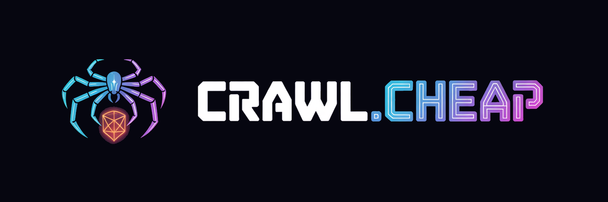
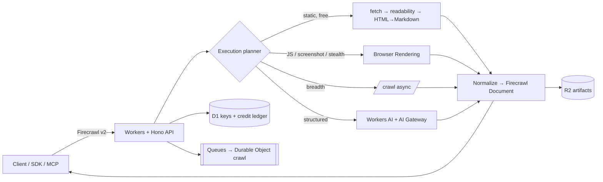
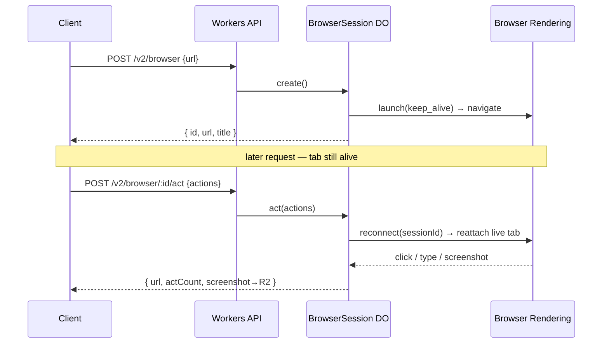

<p align="center">
  
</p>

<h1 align="center">crawl.cheap</h1>

<p align="center">
  <strong>The web data engine for AI. Firecrawl-compatible. Cloudflare-powered. Half the price.</strong>
</p>

<p align="center">
  <a href="https://crawl-cheap-web.manhattan.workers.dev">Website</a> ·
  <a href="https://crawl-cheap-web.manhattan.workers.dev/app/">Console</a> ·
  <a href="https://crawl-cheap-api.manhattan.workers.dev">Live API</a> ·
  <a href="https://crawl-cheap-mcp.manhattan.workers.dev">MCP</a> ·
  <a href="docs/firecrawl-compatibility.md">Compatibility</a> ·
  <a href="docs/implementation-roadmap.md">Roadmap</a> ·
  <a href="deploy/README.md">Self-host</a> ·
  <a href="LICENSE">MIT</a>
</p>

<p align="center">
  <a href="https://github.com/heymegabyte/crawl.cheap/actions/workflows/ci.yml"></a>
  
  
  
  
  
  
</p>

---

crawl.cheap is an open-source, **Cloudflare-native** web-data platform that speaks the
**Firecrawl v1 & v2 APIs** with built-in **Better Auth + OAuth 2.1 Authorization Server** and
**Cloudflare Browser Rendering `/crawl` + "Markdown for Agents" + Workers AI `toMarkdown()`**.
Point an existing Firecrawl client at `api.crawl.cheap`, swap in a crawl.cheap key (`cc_live_…` or
`fc-…`) or OAuth 2.1 bearer token, and keep your code. The managed edition targets **≈50% of
Firecrawl's published plans**; the engine is MIT and self-hostable on your own Cloudflare account.

> **Compatibility means:** change your base URL + use a crawl.cheap key (`cc_live_` or `fc-` format)
> or OAuth 2.1 access token. Your request/response business logic stays identical across both v1 and v2.

## 30-second quickstart

The public demo is live and keyless (rate-limited). Scrape any page to clean Markdown:

```sh
curl -X POST https://crawl-cheap-api.manhattan.workers.dev/v2/scrape \
  -H 'content-type: application/json' \
  -d '{"url":"https://example.com","formats":["markdown","links"]}'
```

Real response (trimmed):

```json
{
  "success": true,
  "data": {
    "url": "https://example.com/",
    "title": "Example Domain",
    "markdown": "This domain is for use in documentation examples without needing permission. This is not a service; avoid relying on it for testing and monitoring purposes.",
    "links": [],
    "metadata": {
      "statusCode": 200,
      "title": "Example Domain",
      "language": "en",
      "sourceURL": "https://example.com/",
      "contentType": "text/html; charset=utf-8"
    }
  }
}
```

<sub>Verbatim from the live endpoint on 2026-10-07 (example.com was redesigned — it no longer links out).</sub>

Map a site's URLs:

```sh
curl -X POST https://crawl-cheap-api.manhattan.workers.dev/v2/map \
  -H 'content-type: application/json' -d '{"url":"https://example.com","limit":50}'
```

## How it works

A request enters a **cheapest-adequate-tier planner**. Most pages never touch a browser — they are
served by a free static path (SSRF-guarded `fetch` → readability extraction → HTML→Markdown). The
browser tier is reserved for pages that truly need JS, actions, screenshots, or an anti-bot proxy.



Edge primitives: **Workers + Hono · Browser Rendering · Queues · Workflows · Durable Objects ·
D1 · R2 · Workers AI · AI Gateway · AI Search**. No portability layer — the CF integration _is_ the
cost and latency advantage. See [`docs/architecture-decisions.md`](docs/architecture-decisions.md).

## What works today

Every row below is live on the production API and covered by a reproducible prod E2E in [`e2e/`](e2e/).

| Capability                                                                                                                                | Status  |
| ----------------------------------------------------------------------------------------------------------------------------------------- | ------- |
| `POST /v2/scrape` + `/v1/scrape` → markdown / html / rawHtml / links / images / summary / branding / attributes / metadata                | ✅ live |
| Cloudflare **"Markdown for Agents"** (`Accept: text/markdown`) + Workers AI `env.AI.toMarkdown()` fast-path                               | ✅ live |
| Cloudflare Browser Rendering native **`/crawl` REST API** (`buildCloudflareCrawlPayload` / `startCloudflareCrawl` / DO sync)              | ✅ live |
| **Better Auth + OAuth 2.1** (`/.well-known/oauth-authorization-server`, DCR `/register`, PKCE `S256`, `/token`, `/revoke`, `/introspect`) | ✅ live |
| `POST /v2/scrape` → `{type:"json"}` AI extraction (Workers AI) + v1 `extract` / `jsonOptions`                                             | ✅ live |
| `POST /v2/scrape` → JS-rendered (Browser Rendering) + `screenshot` / `screenshot@fullPage` → R2                                           | ✅ live |
| `POST /v2/scrape` → `actions` (click/write/press/scroll/wait/screenshot/scrape/executeJavascript/pdf)                                     | ✅ live |
| `POST /v2/scrape` → `changeTracking` (git-diff **+ AI `json` semantic diff**)                                                             | ✅ live |
| `POST /v2/scrape` → `maxAge` result cache (R2, content-addressed) + `storeInCache`                                                        | ✅ live |
| `POST /v2/extract` + `/v1/extract` async structured extraction (Workers AI, Durable Object)                                               | ✅ live |
| `POST /v2/map` (object array) + `POST /v1/map` (`string[]`) → sitemap + link discovery                                                    | ✅ live |
| `POST /v2/crawl` + `/v1/crawl` + `POST /v2/batch/scrape` + `/v1/batch/scrape` async (CF `/crawl` + DO) + status/cancel/errors + webhooks  | ✅ live |
| `POST /v2/crawl/params-preview` → natural-language prompt to crawl parameters (`includePaths`, `excludePaths`, `maxDiscoveryDepth`)       | ✅ live |
| `POST /v2/search` (multi-source `{web,news,images}`) + `POST /v1/search` (flat `Document[]`) + Exa/Tavily + CF edge search fallback       | ✅ live |
| `POST /v2/parse` — PDF (`unpdf` + Workers AI `toMarkdown` + `parsePDF:false` base64 mode) + HTML/text → markdown                          | ✅ live |
| `POST /v2/agent` + `/v1/deep-research` + `/v1/llmstxt` — autonomous research & LLMs.txt generation                                        | ✅ live |
| `POST /v2/monitor` (+ PATCH/DELETE/run/checks) — recurring change detection on Cron **+ signed `monitor.changed` webhooks**               | ✅ live |
| `POST /v2/browser` + `/v2/interact/*` — **persistent interactive browser sessions** + JS code execution                                   | ✅ live |
| `POST /v2/ai-search/index` + `/query` — **AI Search**: semantic search + RAG over your indexed content (Vectorize + Workers AI, per-key)  | ✅ live |
| API keys (`cc_live_` + `fc-` formats), Better Auth sessions, OAuth 2.1 tokens + D1 credit ledger, **enforced spend ceilings** (402)       | ✅ live |
| **100% OpenAPI route coverage**: **v2 57/57** operations + **v1 23/23** operations + Official Firecrawl E2E test suite                    | ✅ live |
| Remote **MCP** — scrape/map/crawl/search + developer/gov/research search + agent + monitor_* + OAuth 2.1 Protected Resource Metadata      | ✅ live |
| Dev **console** `/app/` — Better Auth sign-in/sign-up, GitHub OAuth, `fc-`/`cc_live_` keys, live credits, playground                      | ✅ live |

Full surface map: [`docs/product-surface-inventory.md`](docs/product-surface-inventory.md). Every
unbuilt endpoint returns an honest `501` with a pointer — never a fake success object. Real
wall-clock numbers (static scrape P50 ≈ 100 ms, browser tier ≈ 1.5 s) live in
[`docs/benchmarks.md`](docs/benchmarks.md), reproducible via `node e2e/benchmark/run.mjs`.

## Firecrawl compatibility

Pinned to the real upstream source (there is **no committed v2 OpenAPI** — the contract lives in
Firecrawl's Zod, which we mirror in [`packages/contracts`](packages/contracts)):

| Surface     | Pinned revision                                                                               |
| ----------- | --------------------------------------------------------------------------------------------- |
| REST API v2 | `firecrawl/firecrawl@f9f2e3d`                                                                 |
| MCP server  | `firecrawl-mcp-server@ec0f9de` (`firecrawl-mcp@3.28.2`) — **30 tools registered / 28 listed** |

The MCP server's README says "27 tools"; the source at HEAD registers **30** (28 listable + 2 hidden
deprecated shims). We pin to the source count. Details: [`docs/firecrawl-compatibility.md`](docs/firecrawl-compatibility.md).

## Pricing (managed edition — Stripe not yet live)

Plans are **exactly half of Firecrawl's month-to-month price**, like-for-like credits (re-verified
2026-10-09). The "50% less" claim is measured against Firecrawl's **month-to-month** price; their
annual-billed equivalents ($16/$83/$333/$599) are shown too, and crawl.cheap is cheaper even against those.
Live price book: `GET /v2/pricing`. Preflight a job cost: `POST /v2/quote`.

| Tier     | Monthly credits | Firecrawl (month-to-month) | **crawl.cheap (½)** |
| -------- | --------------: | -------------------------: | ------------------: |
| Free     |           1,000 |                         $0 |              **$0** |
| Hobby    |           5,000 |                        $19 |           **$9.50** |
| Standard |         100,000 |                        $99 |          **$49.50** |
| Growth   |         500,000 |                       $399 |         **$199.50** |
| Scale    |       1,000,000 |                       $749 |         **$374.50** |

**One-time credit packs** (no subscription): $5→2,000 · $10→4,500 · $25→12,000 · $50→26,000 ·
$100→55,000 · $250→145,000 · $500→300,000. Core ops bill at Firecrawl parity; crawl.cheap-exclusive premium
ops (browser/AI/agent) are priced to a proven **≥50% margin floor** against the worst-case lot — never a
half-price loss leader. Cost model + margin proof: [`docs/unit-economics.md`](docs/unit-economics.md) ·
status gates: [`docs/RELEASE_CHECKLIST.md`](docs/RELEASE_CHECKLIST.md). Billing (subscriptions +
packs) is built behind the ledger and resumes the moment a Stripe `sk_test_` key is provisioned.

## Examples

**TypeScript**

```ts
const res = await fetch('https://crawl-cheap-api.manhattan.workers.dev/v2/scrape', {
  method: 'POST',
  headers: { 'content-type': 'application/json' /* , authorization: `Bearer ${crawlcheapKey}` */ },
  body: JSON.stringify({ url: 'https://example.com', formats: ['markdown', 'links'] }),
});
const { data } = await res.json();
console.log(data.markdown);
```

**Python**

```python
import requests
r = requests.post("https://crawl-cheap-api.manhattan.workers.dev/v2/scrape",
                  json={"url": "https://example.com", "formats": ["markdown"]})
print(r.json()["data"]["markdown"])
```

**CLI** (`@crawlcheap/cli` — zero-dependency)

```sh
crawlcheap scrape https://example.com
crawlcheap search "durable objects" --category developer
CRAWLCHEAP_API_KEY=cc_live_… crawlcheap crawl https://docs.site --limit 20 --wait
```

**MCP** — live at `https://crawl-cheap-mcp.manhattan.workers.dev`. Real working tools: `firecrawl_scrape`,
`firecrawl_map`, `firecrawl_crawl`, `firecrawl_check_crawl_status`, `firecrawl_search` (web/news/images),
`firecrawl_developer_search`, `firecrawl_gov_search`, `firecrawl_research_search_papers`,
`firecrawl_research_inspect_paper` / `_related_papers` / `_read_paper` (Semantic Scholar),
`firecrawl_agent`, and `firecrawl_monitor_create` / `_list` / `_run` / `_checks` (the MCP forwards your
Bearer key so authed tools hit your ledger). Only `firecrawl_find_tools` (proprietary) is a stub.
Stateless Streamable-HTTP JSON-RPC.

```jsonc
{
  "mcpServers": { "crawlcheap": { "url": "https://crawl-cheap-mcp.manhattan.workers.dev/v2/mcp" } },
}
```

```sh
# verify it live:
curl -X POST https://crawl-cheap-mcp.manhattan.workers.dev/v2/mcp -H 'content-type: application/json' \
  -d '{"jsonrpc":"2.0","id":1,"method":"tools/call","params":{"name":"firecrawl_scrape","arguments":{"url":"https://example.com"}}}'
```

**Interactive browser sessions** — drive a persistent headless browser; the tab's state (URL,
cookies, form input) survives across separate requests:

```sh
# start a session, then click "next" + screenshot — the tab persists between calls
ID=$(curl -s -X POST https://crawl-cheap-api.manhattan.workers.dev/v2/browser \
  -H 'content-type: application/json' -d '{"url":"https://quotes.toscrape.com/"}' | jq -r .id)
curl -X POST https://crawl-cheap-api.manhattan.workers.dev/v2/browser/$ID/act \
  -H 'content-type: application/json' \
  -d '{"actions":[{"type":"click","selector":"li.next a"},{"type":"screenshot"}]}'
```



Or drive it visually in the [console playground](https://crawl-cheap-web.manhattan.workers.dev/app/).

## Migrating from Firecrawl

```diff
- const base = 'https://api.firecrawl.dev';
- const key  = 'fc-...';
+ const base = 'https://api.crawl.cheap';   // or your self-hosted Worker
+ const key  = 'cc_live_...';                  // a NEW crawl.cheap key — fc- keys are not accepted
```

Or use the **official Firecrawl SDK** unchanged — just point it at crawl.cheap:

```ts
import { Firecrawl } from '@mendable/firecrawl-js';
const app = new Firecrawl({ apiKey: 'cc_live_...', apiUrl: 'https://api.crawl.cheap' });
const doc = await app.scrape('https://example.com', { formats: ['markdown'] });
```

> **Verified against both official SDKs:** `@mendable/firecrawl-js@4.45.0` **8/8** and
> `firecrawl-py@4.49.3` **4/4** run unchanged against crawl.cheap — scrape · map · search · crawl
> (+ batch/extract/status in TS). Reproduce: `node e2e/sdk-compat/test.mjs` · `python e2e/sdk-compat/test.py`.

Your scrape/map/crawl request bodies and response handling stay the same (within the supported
surface above). A crawl.cheap key is required — an existing Firecrawl key is never automatically valid.

## Self-hosting

MIT-licensed; runs on **your** Cloudflare account with no Stripe and no dependency on crawl.cheap
infrastructure. The free static tier needs zero extra provisioning. See [`deploy/README.md`](deploy/README.md).

```sh
git clone https://github.com/heymegabyte/crawl.cheap.git && cd crawl.cheap
pnpm install && cd apps/api && pnpm exec wrangler deploy
```

> **Deploy-to-Cloudflare button:** Cloudflare's one-click button can't resolve a pnpm monorepo's
> workspace packages at build time (documented limitation). The dependency-isolated standalone Worker
> for one-click deploy is a tracked increment — we won't show a "working" badge until it's tested from
> a clean account. The manual command above is verified.

## Security & privacy

- **SSRF-hardened** fetch: blocks private/reserved IPv4+IPv6, cloud-metadata endpoints, non-http(s)
  schemes, and re-validates every redirect hop; optional DNS-over-HTTPS rebinding check.
- Respects `robots.txt` and Cloudflare Content Signals. No CAPTCHA bypass, credential theft, private-
  network scanning, or paywall circumvention.
- **Signed webhooks** (HMAC-SHA256, `x-crawlcheap-signature`) fire on crawl/batch completion **and on
  monitor change detection** (`monitor.changed`), with retries. Webhook targets are SSRF-guarded.
- Zero-data-retention mode, PII redaction, and per-tenant isolation are on the roadmap.
- **Observability:** server-side **Sentry** (`@sentry/cloudflare`) on the API + MCP Workers —
  errors + traces, with every Durable Object instrumented — plus Workers Tracing. No browser SDK.

## Repository layout

```
packages/contracts  Zod SSOT — Firecrawl v2 request/response schemas (the spec mirror)
packages/engine     Cloudflare-native engine — SSRF, fetch, extraction, HTML→MD, planner
apps/api            Hono Worker — the Firecrawl-compatible REST API (live)
docs/               idea-ledger · compatibility · surface-inventory · unit-economics · ADRs · roadmap · convergence-log
deploy/             self-hosting guide + standalone-template plan
```

## Contributing

Issues and PRs welcome. Run `pnpm install`, then `pnpm -r typecheck` and `pnpm --filter @crawlcheap/engine test`.
Add a regression test with every bug fix; keep the Zod contracts authoritative.

## License

[MIT](LICENSE) © 2026 Megabyte Labs. Not affiliated with Firecrawl; "Firecrawl" is used only to
describe API compatibility. A clean-room implementation pinned to public upstream revisions.

---

<p align="center"><strong>Point your client at crawl.cheap. Keep your code. Pay half.</strong></p>
